# Data model

> Generated by `scripts/generate_er_diagrams.py` from the SQLAlchemy models (`backend/app/models/__init__.py`), the Dexie schema (`frontend/src/storage/dexie/db.ts`, row shapes in `db-rows.ts`) and the area mapping `scripts/data_model_areas.yaml`. Do not edit by hand: change a source or the mapping, then run `make sync-data-model`. `make sync-data-model-check` fails when this page is stale, when a table or store belongs to no area, and when a `*_id` field resolves to nothing.

The app keeps its data in one of two databases: the server database (SQLAlchemy on SQLite) or, in browser mode, the browser database (Dexie on IndexedDB). The [storage layer](storage-layer.md) decides which one a page talks to. Every area below shows both.

Server database: 33 tables, 45 foreign keys. Browser database: 38 stores, Dexie schema version 35.

## Reading the diagrams

- An entity with attributes belongs to the area. An entity without attributes belongs to another area: it marks where a relationship leaves the area, and its attributes are in that area's diagram.
- A solid line is a foreign key declared in the server database. A dashed line is a reference by convention that the mapping file records; the browser database declares no foreign keys.
- `PK` primary key, `FK` foreign key, `UK` unique. In the browser diagrams the quoted comment lists the Dexie index entries that contain the field.
- Server types are the SQLAlchemy column types, browser types come from the TypeScript row shapes. Table, store and field names are identifiers and stay as in the code.

## Areas

| Area | Server tables | Browser stores |
|---|---|---|
| Account and settings | 3 | 5 |
| Learning projects | 6 | 6 |
| Sessions | 5 | 5 |
| Progress | 6 | 6 |
| Content | 3 | 5 |
| Gamification | 6 | 6 |
| Import | 2 | 2 |
| AI | 2 | 3 |

## Account and settings

The user, the user's settings with the API keys, and the rollback cache of working API keys; in the browser also the plugin settings and device-local user data.

### Server database

```mermaid
---
config:
  er:
    useMaxWidth: false
---
erDiagram
    accTitle: Data model, Account and settings: server database
    accDescr: Tables of the area Account and settings: users, user_settings, api_key_backups. Relationships: anki_card_suggestions.user_id → users, api_key_backups.user_id → users, curriculums.user_id → users, element_errors.user_id → users, imported_conversations.user_id → users, learning_profiles.user_id → users, learning_projects.user_id → users, lesson_progress.user_id → users, set_runs.user_id → users, speech_recordings.user_id → users, study_questions.user_id → users, tags.user_id → users, user_badges.user_id → users, user_missions.user_id → users, user_settings.user_id → users, user_streaks.user_id → users, user_xp.user_id → users, xp_purchases.user_id → users.
    users {
        String id PK
        String name
        String email UK
        String language
        DateTime created_at
        DateTime updated_at
    }
    user_settings {
        String id PK
        String user_id FK, UK
        String active_provider
        Text api_key_anthropic
        Text api_key_openai
        Text api_key_gemini
        Text api_key_perplexity
        String model_override_anthropic
        String model_override_openai
        String model_override_gemini
        String model_override_perplexity
        Text avatar
        DateTime created_at
        DateTime updated_at
    }
    api_key_backups {
        String id PK
        String user_id FK
        String provider
        Text encrypted_key
        DateTime tested_at
        Boolean works
        DateTime created_at
        DateTime updated_at
    }
    users ||--o{ anki_card_suggestions : "user_id"
    users ||--o{ api_key_backups : "user_id"
    users ||--o{ curriculums : "user_id"
    users ||--o{ element_errors : "user_id"
    users ||--o{ imported_conversations : "user_id"
    users ||--o{ learning_profiles : "user_id"
    users ||--o{ learning_projects : "user_id"
    users ||--o{ lesson_progress : "user_id"
    users ||--o{ set_runs : "user_id"
    users ||--o{ speech_recordings : "user_id"
    users ||--o{ study_questions : "user_id"
    users ||--o{ tags : "user_id"
    users ||--o{ user_badges : "user_id"
    users ||--o{ user_missions : "user_id"
    users ||--o| user_settings : "user_id"
    users ||--o| user_streaks : "user_id"
    users ||--o| user_xp : "user_id"
    users ||--o{ xp_purchases : "user_id"
```

### Browser database

```mermaid
---
config:
  er:
    useMaxWidth: false
---
erDiagram
    accTitle: Data model, Account and settings: browser database
    accDescr: Stores of the area Account and settings: users, userSettings, apiKeyBackups, pluginSettings, userData. Relationships: userSettings.user_id → users, apiKeyBackups.user_id → users, learningProjects.user_id → users, learningProfiles.user_id → users, tags.user_id → users, lessonProgress.user_id → users, elementErrors.user_id → users, setRuns.user_id → users, speechRecordings.user_id → users, curricula.user_id → users, userXp.user_id → users, xpPurchases.user_id → users, userBadges.user_id → users, userStreaks.user_id → users, userMissions.user_id → users, importedConversations.user_id → users, ankiCards.user_id → users, studyQuestions.user_id → users.
    users {
        string id PK
        string name
        string email "email"
        string language
        string created_at
        string updated_at
    }
    userSettings {
        string id PK
        string user_id UK "&user_id"
        string language
        AIProvider active_provider
        string api_key_anthropic
        string api_key_openai
        string api_key_gemini
        string api_key_perplexity
        string model_override_anthropic
        string model_override_openai
        string model_override_gemini
        string model_override_perplexity
        string avatar
        string created_at
        string updated_at
    }
    apiKeyBackups {
        string id PK
        string user_id "user_id"
        AIProvider provider "provider"
        string key
        string tested_at
        boolean works
    }
    pluginSettings {
        string name PK
        Record settings
        string updated_at
    }
    userData {
        string key PK
        string value
    }
    users ||..o| userSettings : "user_id"
    users ||..o{ apiKeyBackups : "user_id"
    users ||..o{ learningProjects : "user_id"
    users ||..o{ learningProfiles : "user_id"
    users ||..o{ tags : "user_id"
    users ||..o{ lessonProgress : "user_id"
    users ||..o{ elementErrors : "user_id"
    users ||..o{ setRuns : "user_id"
    users ||..o{ speechRecordings : "user_id"
    users ||..o{ curricula : "user_id"
    users ||..o| userXp : "user_id"
    users ||..o{ xpPurchases : "user_id"
    users ||..o{ userBadges : "user_id"
    users ||..o| userStreaks : "user_id"
    users ||..o{ userMissions : "user_id"
    users ||..o{ importedConversations : "user_id"
    users ||..o{ ankiCards : "user_id"
    users ||..o{ studyQuestions : "user_id"
```

| Server table | Browser store |
|---|---|
| `users` | `users` |
| `user_settings` | `userSettings` |
| `api_key_backups` | `apiKeyBackups` |
| - | `pluginSettings` |
| - | `userData` |

## Learning projects

A learning project with the learning profile from the assessment, and the subjects and tags that classify projects.

### Server database

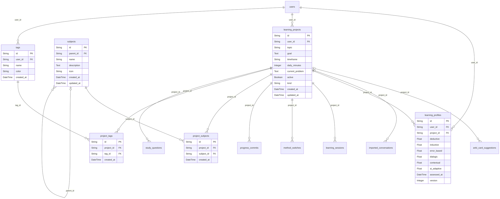

### Browser database

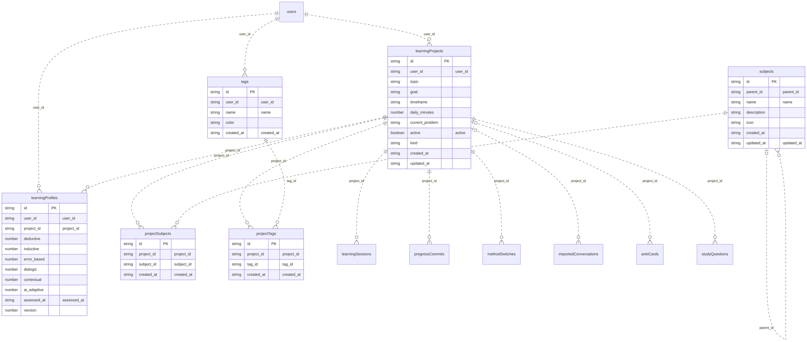

| Server table | Browser store |
|---|---|
| `learning_projects` | `learningProjects` |
| `learning_profiles` | `learningProfiles` |
| `subjects` | `subjects` |
| `tags` | `tags` |
| `project_subjects` | `projectSubjects` |
| `project_tags` | `projectTags` |

## Sessions

A learning session with its messages, ratings, notes and step evaluations.

### Server database

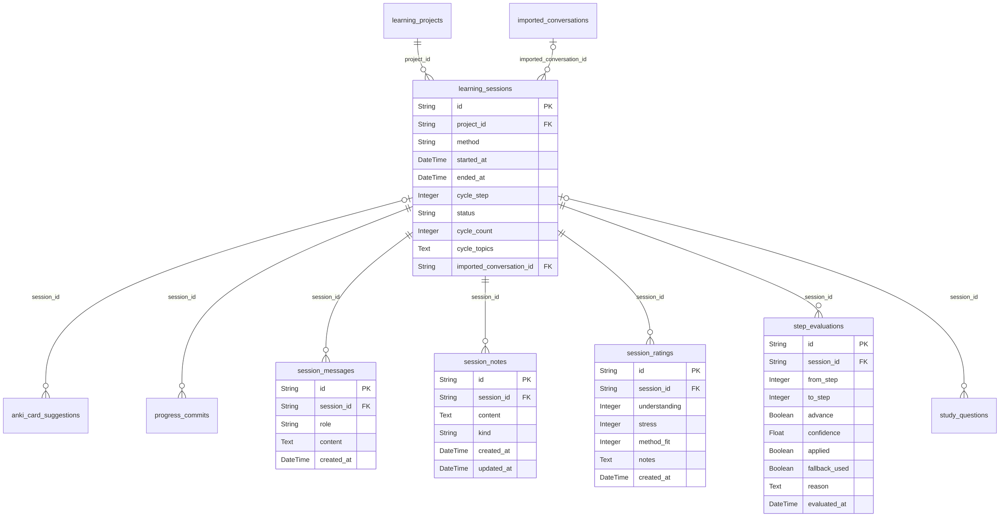

### Browser database

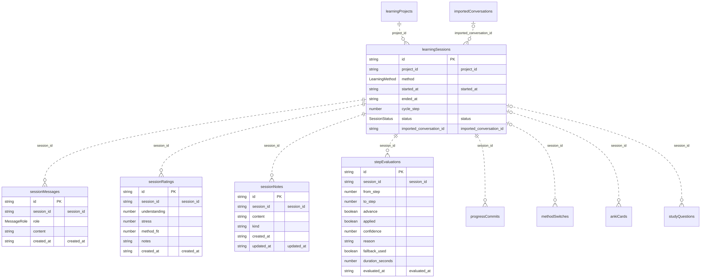

| Server table | Browser store |
|---|---|
| `learning_sessions` | `learningSessions` |
| `session_messages` | `sessionMessages` |
| `session_ratings` | `sessionRatings` |
| `session_notes` | `sessionNotes` |
| `step_evaluations` | `stepEvaluations` |

## Progress

Progress commits and method switches of a project, lesson progress in content sets, element-level errors for spaced repetition, set runs and speech recordings.

### Server database

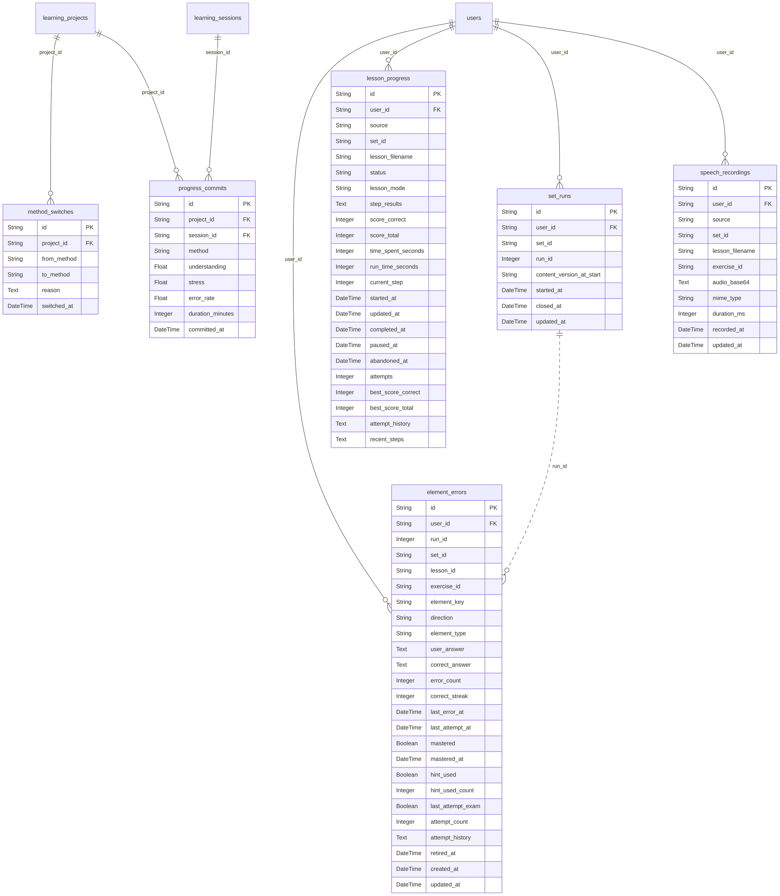

### Browser database

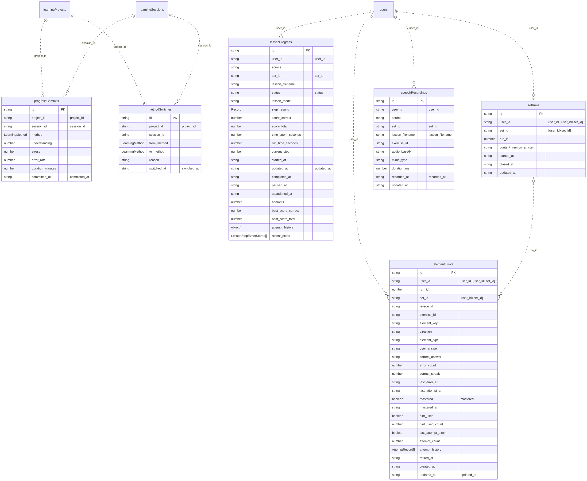

| Server table | Browser store |
|---|---|
| `progress_commits` | `progressCommits` |
| `method_switches` | `methodSwitches` |
| `lesson_progress` | `lessonProgress` |
| `element_errors` | `elementErrors` |
| `set_runs` | `setRuns` |
| `speech_recordings` | `speechRecordings` |

## Content

Curricula with their topics and lessons; in the browser also the cache of downloaded content sets and their files.

### Server database

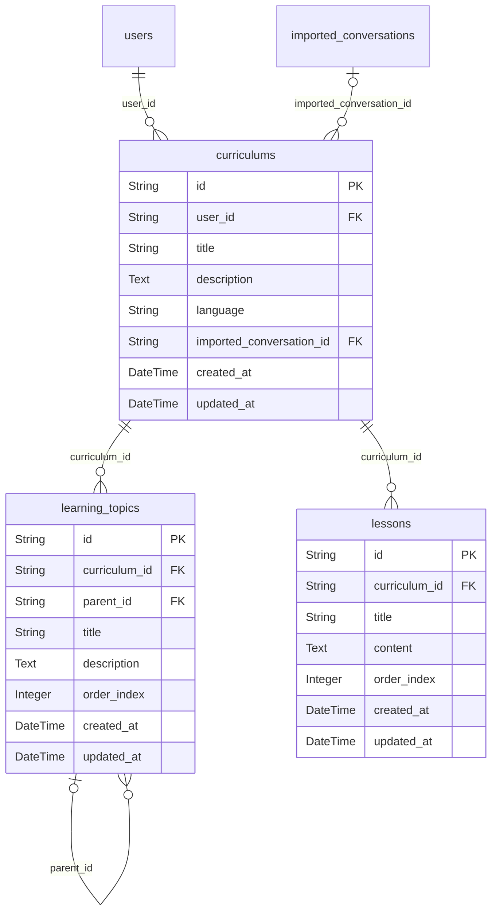

### Browser database

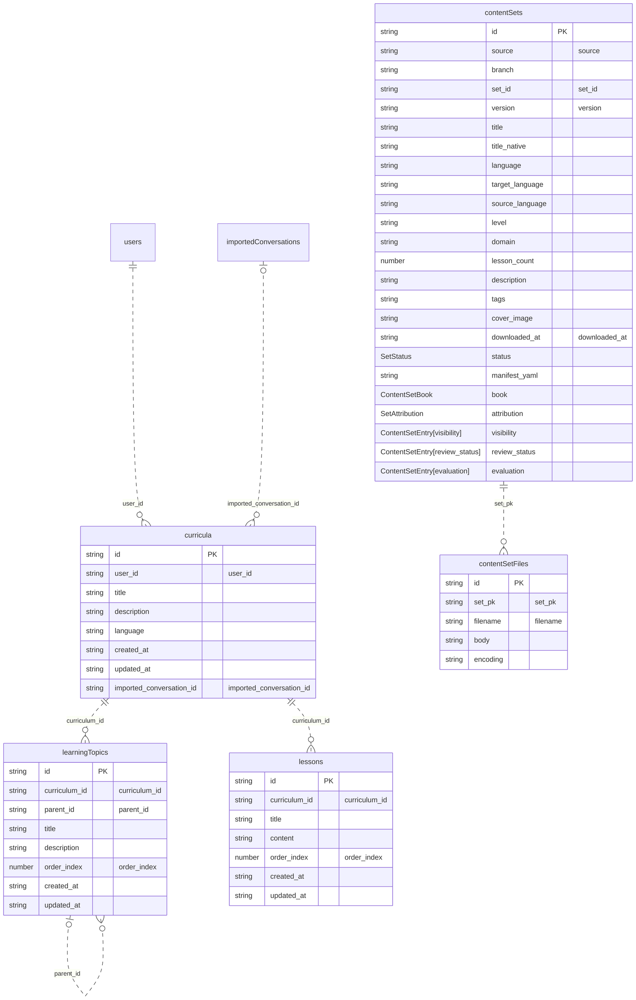

| Server table | Browser store |
|---|---|
| `curriculums` | `curricula` |
| `learning_topics` | `learningTopics` |
| `lessons` | `lessons` |
| - | `contentSets` |
| - | `contentSetFiles` |

## Gamification

XP and XP purchases, the badge catalog with the earned badges, streaks and daily missions.

### Server database

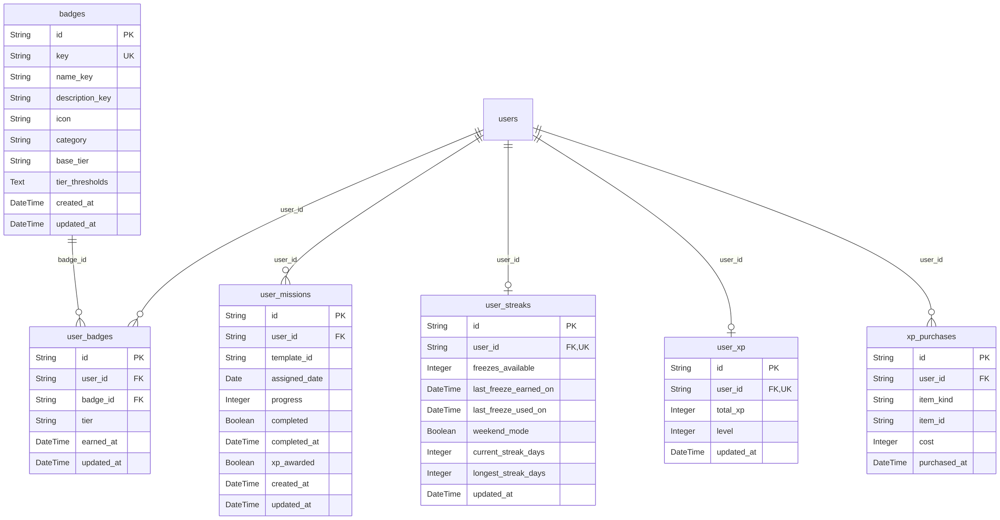

### Browser database

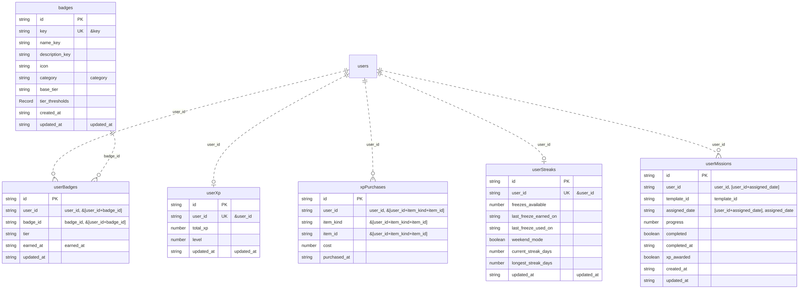

| Server table | Browser store |
|---|---|
| `user_xp` | `userXp` |
| `xp_purchases` | `xpPurchases` |
| `badges` | `badges` |
| `user_badges` | `userBadges` |
| `user_streaks` | `userStreaks` |
| `user_missions` | `userMissions` |

## Import

Imported chat conversations and their messages.

### Server database

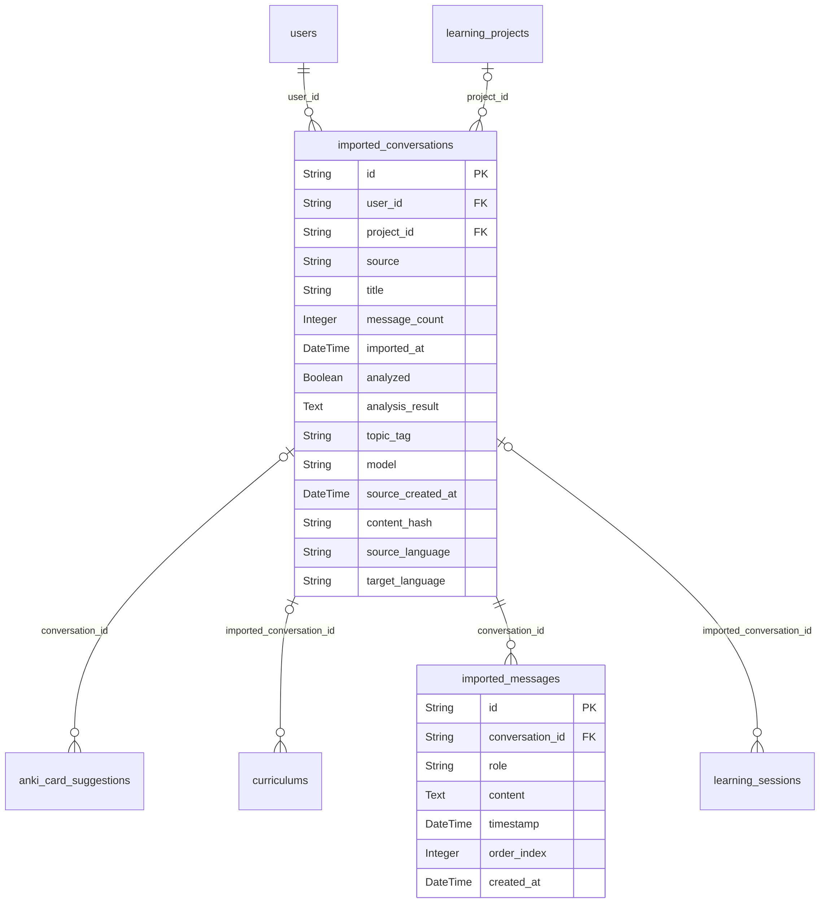

### Browser database

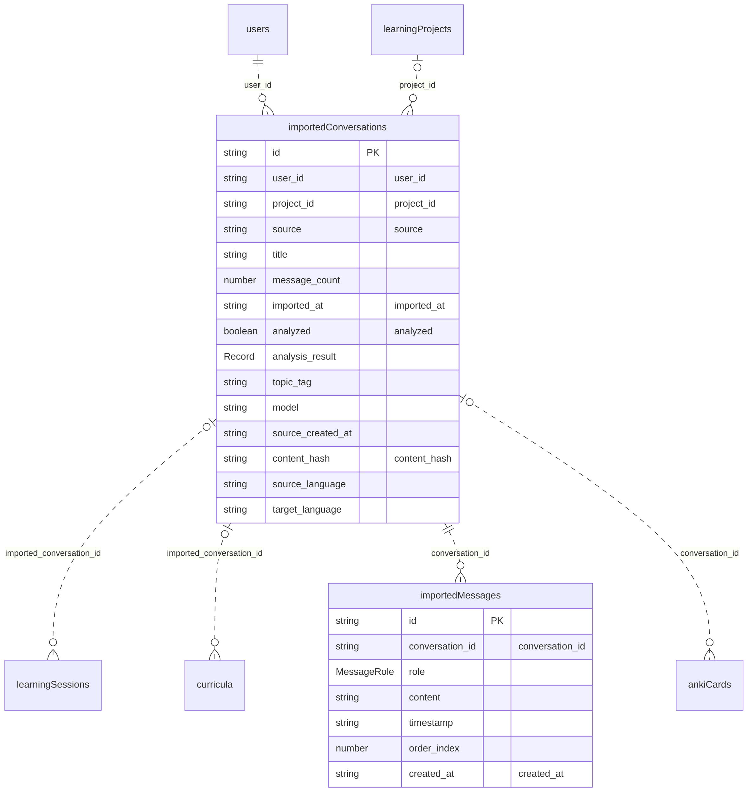

| Server table | Browser store |
|---|---|
| `imported_conversations` | `importedConversations` |
| `imported_messages` | `importedMessages` |

## AI

AI-generated Anki card suggestions and study questions; in the browser also the cached reports of the AI content check.

### Server database

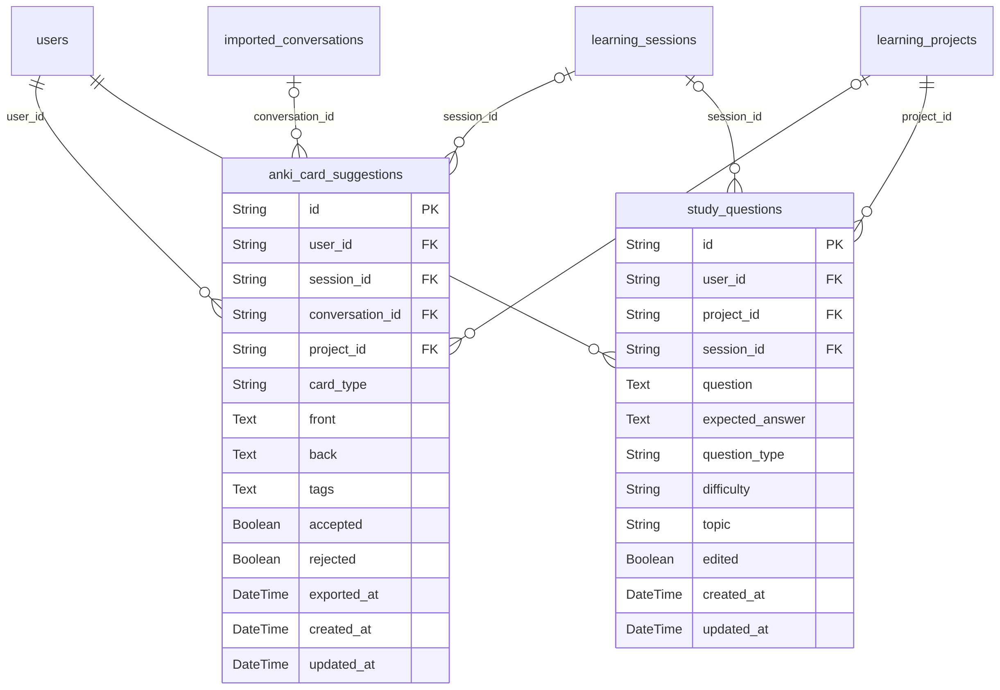

### Browser database

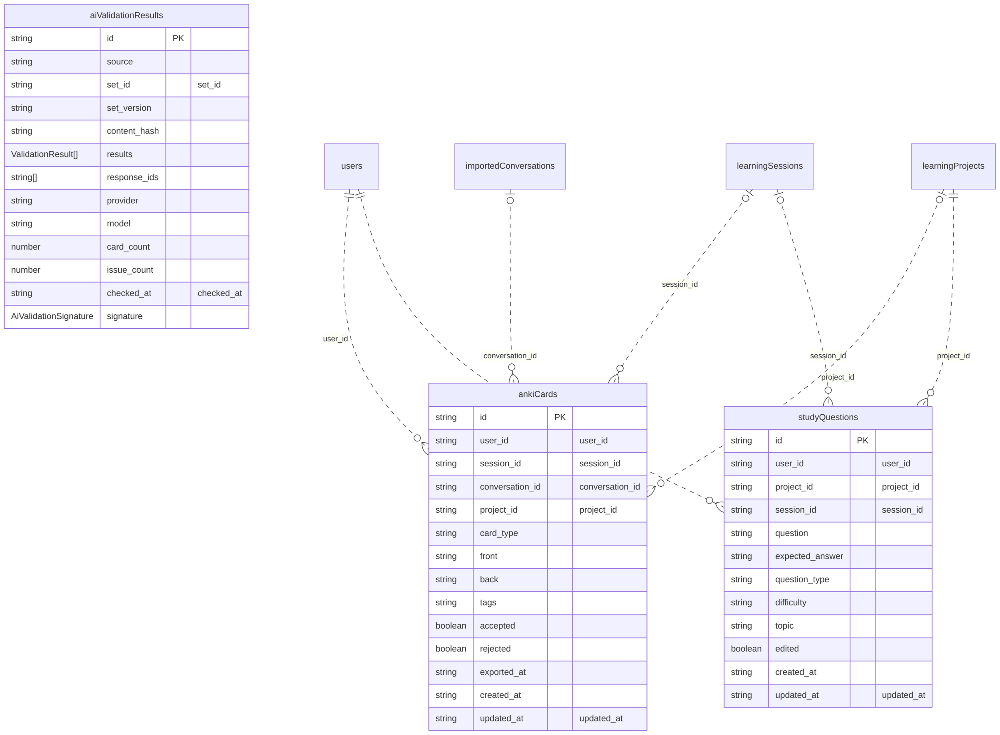

| Server table | Browser store |
|---|---|
| `anki_card_suggestions` | `ankiCards` |
| `study_questions` | `studyQuestions` |
| - | `aiValidationResults` |

## Fields the mapping file resolves

The browser database declares no foreign keys, and some server columns carry none either. The mapping file resolves every such `*_id` field: as a reference (a dashed line above), as a pointer to something outside the database, or as an identifier that refers to nothing. The fields it gives a reason for are listed here; the reasons come verbatim from the mapping file and stay in English.

| Database | Field | Resolved as | Reason |
|---|---|---|---|
| server | `element_errors.exercise_id` | outside the database | id of an exercise inside a lesson of a content set |
| server | `element_errors.lesson_id` | outside the database | id of a lesson inside a content set, referenced by its string id |
| server | `element_errors.run_id` | reference to `set_runs` | with user_id and set_id names a run in set_runs (unique per user, set and run); no foreign key because rows from before set runs existed get their set_runs row only when the run is first read or written |
| server | `element_errors.set_id` | outside the database | id of a content set from a content repository; the set lives in the content cache on disk, not in the database |
| server | `lesson_progress.set_id` | outside the database | id of a content set from a content repository; the set lives in the content cache on disk, not in the database |
| server | `set_runs.run_id` | not a reference | the run's own number within its user and set (1, 2, ...) |
| server | `set_runs.set_id` | outside the database | id of a content set from a content repository; the set lives in the content cache on disk, not in the database |
| server | `speech_recordings.exercise_id` | outside the database | id of an exercise inside a lesson of a content set |
| server | `speech_recordings.set_id` | outside the database | id of a content set from a content repository; the set lives in the content cache on disk, not in the database |
| server | `user_missions.template_id` | outside the database | id of a mission template in the missions plugin's catalog (templates.yaml) |
| server | `xp_purchases.item_id` | outside the database | id of an avatar frame, mascot variant or arcade game from the frontend shop catalogs; item_kind says which |
| browser | `aiValidationResults.set_id` | outside the database | id of the checked content set; the report's id is source#set_id |
| browser | `contentSets.set_id` | outside the database | the set's own id from the content repository manifest; with source and version it forms the cache key id |
| browser | `elementErrors.exercise_id` | outside the database | id of an exercise inside a lesson of a content set |
| browser | `elementErrors.lesson_id` | outside the database | id of a lesson inside a content set, referenced by its string id |
| browser | `elementErrors.run_id` | reference to `setRuns` | with user_id and set_id names a run in setRuns; the run of a row from before set runs existed is created only when it is first read or written |
| browser | `elementErrors.set_id` | outside the database | id of a content set from a content repository; contentSets keys a cached set by source, set_id and version, so set_id alone names no single row |
| browser | `lessonProgress.set_id` | outside the database | id of a content set from a content repository; contentSets keys a cached set by source, set_id and version, so set_id alone names no single row |
| browser | `setRuns.run_id` | not a reference | the run's own number within its user and set (1, 2, ...) |
| browser | `setRuns.set_id` | outside the database | id of a content set from a content repository; contentSets keys a cached set by source, set_id and version, so set_id alone names no single row |
| browser | `speechRecordings.exercise_id` | outside the database | id of an exercise inside a lesson of a content set |
| browser | `speechRecordings.set_id` | outside the database | id of a content set from a content repository; contentSets keys a cached set by source, set_id and version, so set_id alone names no single row |
| browser | `userMissions.template_id` | outside the database | id of a mission template in the missions plugin's catalog (templates.yaml) |
| browser | `xpPurchases.item_id` | outside the database | id of an avatar frame, mascot variant or arcade game from the frontend shop catalogs; item_kind says which |
